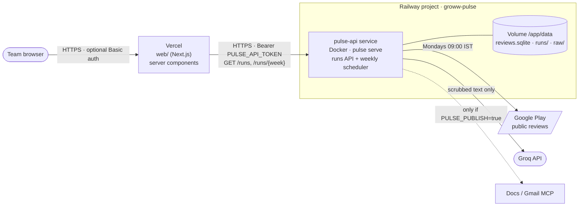

# Deployment — Railway (backend) + Vercel (web)

> Builds on [architecture.md](./architecture.md) §4.11 (web frontend) and §7 (execution model).
> Implementation: [implementation-plan.md](./implementation-plan.md) Phase 10.

## 1. Topology



| Piece | Where | What it does |
|-------|-------|--------------|
| `pulse-api` | Railway, one Docker service, 1 replica | `pulse serve`: the read-only runs API for the web app, an authenticated trigger, and the weekly scheduler that runs the pipeline in-process |
| Volume | Railway, mounted at `/app/data` | `reviews.sqlite`, `runs/<week>/`, raw snapshots (purged after 14 days by the pipeline) |
| `web/` | Vercel, root directory `web` | The Next.js viewer. Reads runs from `pulse-api` on the server side only; the browser never sees the API token |

### Why this shape

- **The web app can't read files on Vercel.** The local viewer reads `data/runs/` from disk. On Vercel there is no
  shared disk, so the backend serves the same four files over HTTP and `web/lib/runs.ts` switches to the API when
  `PULSE_API_URL` is set. Local dev and tests keep using the filesystem.
- **One Railway service, not two.** A Railway volume attaches to a single service. The scheduled pipeline writes
  the runs and the API reads them, so both live in one process: `pulse serve` starts the API and a scheduler thread.
  A separate cron service would need its own volume and couldn't share the data.
- **One replica.** The volume and the per-week file lock assume a single writer.
- **The scheduler is restart-safe.** Every 10 minutes it checks: is it past Monday 09:00 IST, and does this week
  have no `run.json` yet? If so it starts the run. A deploy or crash during the slot only delays the run, and a week
  that already ran (ok or failed) is never repeated automatically. Re-runs are manual via the trigger endpoint.
- **Dry run by default.** Scheduled runs write `pulse.md` and `run.json` but publish nothing until
  `PULSE_PUBLISH=true`, the same switch the GitHub Actions job uses (see §6).

## 2. Backend API (`src/groww_pulse/api.py`)

| Route | Auth | Returns |
|-------|------|---------|
| `GET /health` | none | `{"ok": true}`. Railway health check |
| `GET /runs` | Bearer | `{"runs": [{week, run, themes}], "active": [weeks running now]}`, newest first |
| `GET /runs/{week}` | Bearer | `{week, run, themes, quotes, pulse_md}`. Quotes carry text, rating and theme only (no `review_id`) |
| `POST /runs/{week}/trigger?dry_run=true` | Bearer | 202 and starts a run in the background. 409 if that week is already running. `dry_run=false` → 403 unless `PULSE_PUBLISH=true` |

- The app **refuses to start** without `PULSE_API_TOKEN` (≥ 16 characters). Tokens are compared in constant time.
- Week ids are validated as real ISO weeks before any path is built (`2025-W53` → 404, `../x` → 404).
- No OpenAPI or docs routes are exposed.
- Nothing returns review text except the validated pulse and its 3 quotes, which are already scrubbed.

## 3. Configuration

### Railway (`pulse-api` service variables)

| Variable | Required | Value |
|----------|----------|-------|
| `GROQ_API_KEY` | yes | Groq key |
| `PULSE_ID_SALT` | yes | The **same** salt as your local `.env`, so review ids stay stable. Never change it after the first run |
| `PULSE_API_TOKEN` | yes | `python -c "import secrets; print(secrets.token_urlsafe(32))"`. Also set in Vercel |
| `PULSE_PUBLISH` | no | `false` (default). `true` only once HTTP MCP servers are configured (§6) |
| `PULSE_SCHEDULE` | no | `true` (default). `false` turns the in-process weekly scheduler off |
| `GMAIL_MCP_AUTH` | no | Header value for an HTTP Gmail MCP server, if `config.yaml` references it |
| `PORT` | set by Railway | `pulse serve` listens on it |

Files: `Dockerfile`, `.dockerignore` and `railway.json` (Dockerfile builder, `/health` check, restart on failure,
1 replica, rebuilds only on backend paths).

**Image:** `python:3.12-slim` with CPU-only torch, an editable install (prompts and the Jinja template are read
relative to the repo), and `en_core_web_sm` plus `all-MiniLM-L6-v2` baked in, so runs download no models.
Plan for about **2 GB RAM** during a run (torch + MiniLM + spaCy). The API alone idles at a few hundred MB.

### Vercel (project with root directory `web`)

| Variable | Required | Value |
|----------|----------|-------|
| `PULSE_API_URL` | yes | `https://<pulse-api>.up.railway.app` (no trailing slash needed) |
| `PULSE_API_TOKEN` | yes | Same value as Railway. Server-only, with no `NEXT_PUBLIC_` prefix, so it is never sent to browsers |
| `WEB_BASIC_AUTH` | recommended | `user:password`. `web/middleware.ts` puts HTTP Basic auth in front of every page. Use Vercel Deployment Protection instead if your plan has it |

`web/vercel.json` pins the framework, `npm ci`, the build command, and the function region `sin1` (Singapore), next
to Railway's `asia-southeast1` region, so the web → API hop stays short. Pick the Railway region to match.

## 4. Rollout steps

### 4.1 Railway backend

```bash
npm i -g @railway/cli            # or: npx @railway/cli <cmd>
railway login
railway init --name groww-pulse  # new project, from the repo root
railway add --service pulse-api  # empty service the repo deploys into
railway service pulse-api        # link this directory to it
railway volume add --mount-path /app/data
railway variables --set "GROQ_API_KEY=..." --set "PULSE_ID_SALT=..." \
                  --set "PULSE_API_TOKEN=..." --set "PULSE_PUBLISH=false"
railway up --detach              # builds the Dockerfile, deploys, waits for /health
railway domain                   # generates https://<pulse-api>.up.railway.app
```

Set the service region to **Southeast Asia (Singapore)** in the service settings. To deploy on every push instead
of using `railway up`, connect the GitHub repo to the service in the dashboard. `railway.json` limits rebuilds to
backend paths.

Smoke test, then produce the first pulse:

```bash
API=https://<pulse-api>.up.railway.app; TOKEN=...
curl -s $API/health                                                    # {"ok":true}
curl -s -o /dev/null -w '%{http_code}\n' $API/runs                     # 401
curl -s -X POST -H "Authorization: Bearer $TOKEN" "$API/runs/2026-W43/trigger?dry_run=true"   # 202
railway logs                                                           # "run week=2026-W43 status=dry_run ..."
curl -s -H "Authorization: Bearer $TOKEN" $API/runs                    # the week appears
```

### 4.2 Vercel web

```bash
npm i -g vercel                  # or: npx vercel <cmd>
cd web
vercel login
vercel link                      # create the project; root directory = web
vercel env add PULSE_API_URL production
vercel env add PULSE_API_TOKEN production
vercel env add WEB_BASIC_AUTH production
vercel deploy --prod
```

With the Git integration instead: import the repo in Vercel, set **Root Directory = `web`**, add the three
variables, and every push to `main` deploys (pull requests get preview deployments, which read the same
production API if you add the variables to Preview too).

### 4.3 Verification checklist

- [ ] `GET /health` is 200 and `GET /runs` without a token is 401
- [ ] The first triggered dry run finishes (`railway logs`) and `/runs` lists the week
- [ ] The Vercel URL asks for Basic auth, then shows the week with its pulse, themes and quotes
- [ ] `/runs/2026-W01` (no such run) shows the not-found page
- [ ] The page HTML contains no `review_id`, and the browser's network tab shows no calls to Railway (server-side only)
- [ ] The next Monday after 09:00 IST, `railway logs` shows `scheduled run started for <week>`

## 5. Operations

| Task | How |
|------|-----|
| Re-run a week | `POST /runs/{week}/trigger?dry_run=true`. 409 while one is running |
| See what happened | `railway logs` (one line per run: week, status, flags, error), or the run page in the web app |
| Rotate the API token | Set the new `PULSE_API_TOKEN` in Railway and Vercel, then redeploy both (Vercel needs a redeploy for env changes) |
| Back up data | `railway volume` snapshots, or `railway run -- tar czf - data` locally. Only scrubbed data is kept beyond 14 days |
| Roll back | Railway: redeploy the previous deployment. Vercel: promote the previous deployment |
| Backend down | The web app shows "Can't load runs right now" (500) instead of stale or partial data |

## 6. Publishing from Railway (Docs + Gmail via MCP)

The image has no Node.js and no interactive browser, so **stdio MCP servers started with `npx`** that need a
one-time OAuth login don't work in it as they are. Options, in order of preference:

1. **HTTP MCP servers** (`transport: http` in `config.yaml`, header values from env such as `GMAIL_MCP_AUTH`). Auth
   stays inside the MCP server, and the container only needs the URL and header variable. Then set
   `PULSE_PUBLISH=true`.
2. Keep publishing where the OAuth already lives: the scheduled GitHub Actions job or a local `pulse publish
   --week <week>`.

Until then, Railway produces and serves validated dry-run pulses, and publishing stays a separate, deliberate step.

**Avoid double scheduling.** The GitHub Actions `pulse` job also runs every Monday. Once Railway is the runner, set
the repository variable `PULSE_RUNNER=railway`, and the workflow skips its own pulse job (evals still run).

## 7. Security notes

- Two secrets cross the network boundary. `PULSE_API_TOKEN` is shared between Vercel and Railway as server-side env
  only. `WEB_BASIC_AUTH` gates the site.
- The API is read-only apart from the trigger, which can only start a run for a valid week, and publishing needs
  the separate `PULSE_PUBLISH` switch.
- Privacy is the same as locally: quote provenance is dropped by the API **and** again by the web layer, MCP logs
  show argument keys only, and raw snapshots on the volume are purged after 14 days.
- Groq stays the only model service that receives text, and it gets scrubbed text only (architecture.md §3.1).
